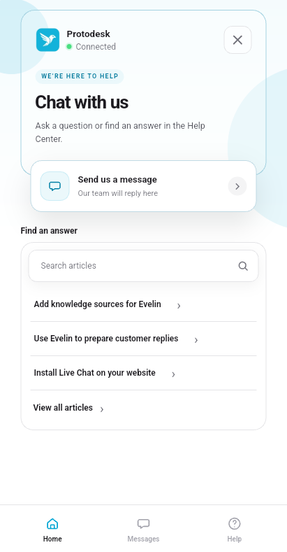
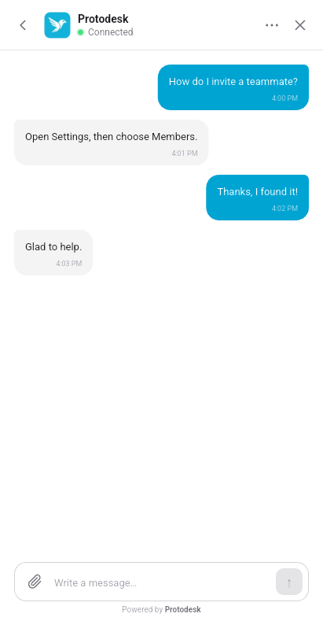
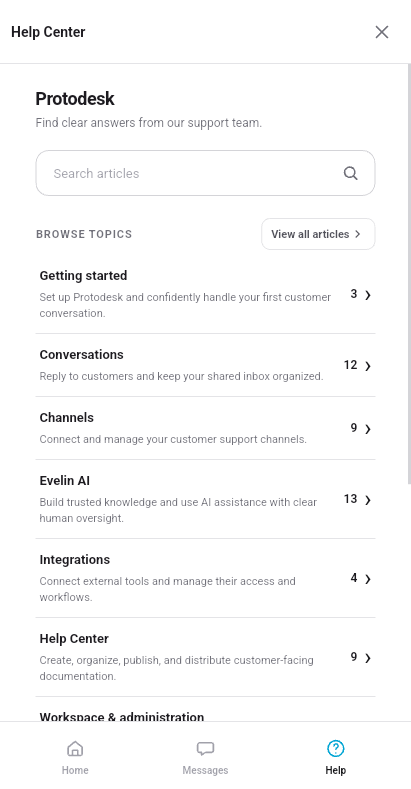
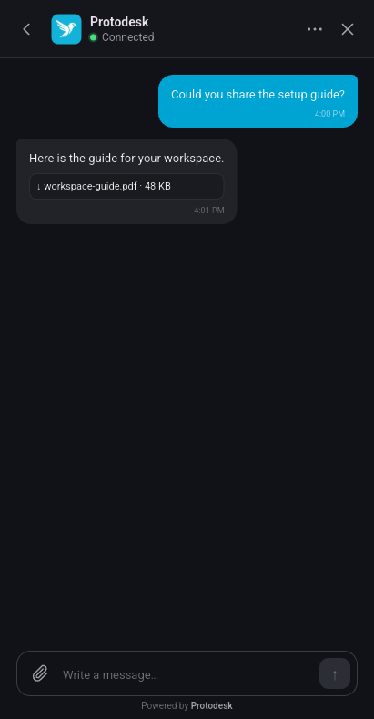

# Protodesk Chat for Flutter

[](https://pub.dev/packages/protodesk_chat)
[](https://github.com/Protodesk/protodesk-chat-flutter/actions/workflows/checks.yml)
[](LICENSE)

Let customers message your team and search your published Help Center inside your
Android or iOS app. The native Flutter messenger uses your Protodesk Chat App’s
branding and content. Your team replies from the same Protodesk inbox as website chat.

<p>
  
  
  
  
</p>

*From left to right, Home, a conversation, the Help Center, and a PDF attachment in dark mode. Captured on a Pixel 7a emulator with sample conversations.*

## Try the example

From a checkout, start the anonymous example on an Android or iOS device or emulator.
Enter your HTTPS API origin and public Chat App ID, then choose the first-use
option to create a visitor. The example also has a signed-in flow and a native
file picker. [Example app and setup](https://github.com/Protodesk/protodesk-chat-flutter/tree/main/example)

```sh
cd example
flutter pub get
flutter run -t lib/main_anonymous.dart
```

## Add chat to your app

Requires Flutter 3.47.5 or later, Dart 3.13.4 or later in the 3.x series, and
Android API 24+ or iOS 13+. On Android, declare `android.permission.INTERNET` in
the app’s main manifest. For secure session storage, configure Android backup
exclusions and iOS Keychain entitlements. [Native host configuration](https://github.com/Protodesk/protodesk-chat-flutter/blob/main/docs/guide.md#native-host-configuration)

```sh
flutter pub add protodesk_chat
```

### Connect a signed-in customer

Create one client for the signed-in account. Supply its stable, opaque account
ID and a callback to your authenticated backend. The backend holds your Chat App
secret and mints a fresh identity token each time the SDK calls the callback.
[Example backend contract](https://github.com/Protodesk/protodesk-chat-flutter/blob/main/example/README.md#verified-host-integration)

```dart
import 'dart:io';

import 'package:protodesk_chat/protodesk_chat_ui.dart';

Future<ProtodeskChatClient> connectSupport({
  required String publicChatAppId,
  required String accountId,
  required ChatIdentityTokenProvider fetchToken,
}) {
  return initializeChat(ChatClientOptions(
    baseUrl: Uri.parse('https://api.protodesk.io'),
    publicChatAppId: publicChatAppId,
    platform: Platform.operatingSystem,
    storage: const PlatformChatStorage(),
    identityKey: accountId,
    identityTokenProvider: fetchToken,
  ));
}
```

For anonymous visitors, omit the account ID and token provider from the options.
With secure storage enabled, pass `allowNewAnonymousIdentity: true` when the
visitor first chooses to start a new identity. [Anonymous sessions and recovery](https://github.com/Protodesk/protodesk-chat-flutter/blob/main/docs/guide.md#secure-persistence-and-recovery)

### Open the messenger

Use the SDK launcher as a `Scaffold.floatingActionButton` inside your app’s
navigator. You can also call `client.openChat(context)` from an existing button.

```dart
ChatLauncherButton(
  label: 'Open support chat',
  onPressed: () => client.openChat(context),
)
```

To open Help directly, call `client.openHelpCenter(context)`. Reusing the same
client and navigator lets customers close and reopen chat with their screen and
unsent draft intact, or return to the Help article they were reading. On account
sign-out, call `await client.logout()` and release the client with
`await client.dispose()` in a `finally` block.

## Integration guides

| Task | Guide |
| --- | --- |
| Queue messages offline and recover sends after restart | [Offline sending](https://github.com/Protodesk/protodesk-chat-flutter/blob/main/docs/guide.md#optimistic-text-sends-and-bounded-offline-queue) |
| Add a file picker and handle attachment previews | [Attachments](https://github.com/Protodesk/protodesk-chat-flutter/blob/main/docs/guide.md#foreground-attachments) |
| Open a conversation from an FCM, APNs, or OneSignal notification | [Push adapters](https://github.com/Protodesk/protodesk-chat-flutter/tree/main/examples/push_adapters) |
| Set the theme or use English and Indonesian UI strings | [Appearance and localization](https://github.com/Protodesk/protodesk-chat-flutter/blob/main/docs/guide.md#themes-language-and-accessibility) |
| Build a custom interface with `protodesk_chat.dart` | [Client integration guide](https://github.com/Protodesk/protodesk-chat-flutter/blob/main/docs/guide.md) |

## Development

For local checks, screenshot updates, and release validation, see
[Contributing](https://github.com/Protodesk/protodesk-chat-flutter/blob/main/CONTRIBUTING.md).
The SDK has Android emulator and iOS simulator coverage. Physical-device
qualification is still pending. [Test coverage](https://github.com/Protodesk/protodesk-chat-flutter/blob/main/docs/testing.md)

## License

[Apache License 2.0](LICENSE). Bundled Inter fonts are distributed under the
[SIL Open Font License](assets/fonts/OFL.txt).
