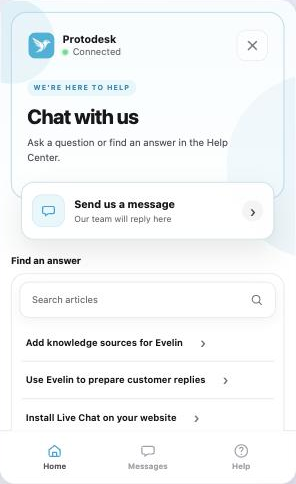
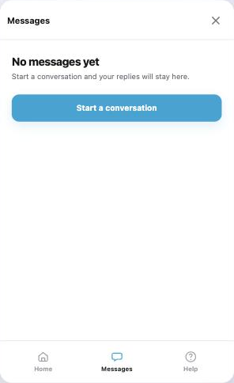
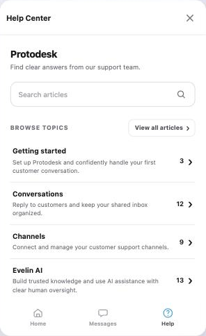
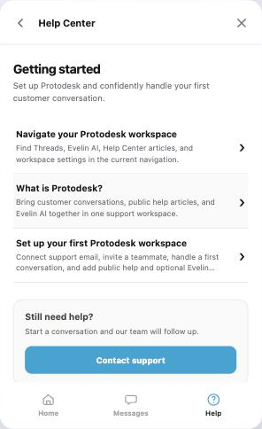
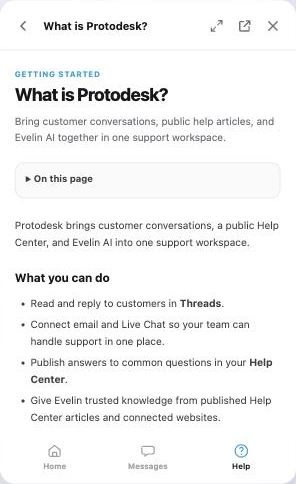

# Plan: Livechat-style Flutter UI with Home, Messages and Help

Status: approved 2026-10-25 with all five recommended decisions (section 7).
All seven phases are implemented in the unpublished preview; see
[`livechat-quality-audit.md`](livechat-quality-audit.md) for the phase 7 audit
(15/20, Good) and what still needs physical devices.

Deviations so far:
- Home's "Find an answer" panel (Help search and suggestions) moved from phase 3
  to phase 4, because every item in it opens a Help view.
- The thread stays inside `ChatMessenger` and replaces the tabs while open, as
  the web widget does, instead of a separate `ChatThreadPage` route.
- Without `onOpenLink`, Home hides configured links rather than listing
  links that cannot open, and Help article links render as plain text.
- The article view omits the web widget's "expand" control (the messenger is
  already full screen) and the collection kicker above the title (a banned
  eyebrow pattern); the header shows the Help Center name instead.
- Conversations are still created when setup completes (or when "Send us a
  message" is tapped), not lazily on the first message as on the web widget;
  the greeting shows in the empty thread instead. The setup heading omits the
  web's app-name eyebrow.
- Help chrome follows the app's locale (English/Indonesian); article content
  and its text direction follow the Help Center's active locale.
- Home is the default section (`initialSection`); a push or
  `initialConversationId` still opens the thread directly.

Goal: make the Flutter SDK's prebuilt UI feel like the Protodesk web livechat
widget (`protodesk-web/src/widget`): the same three tabs, the same flows and
copy, the same Help Center, using native Flutter (Material 3) components and
the existing headless client underneath.

Reference screenshots of the live widget on protodesk.io (2026-10-25) are in
[`livechat-reference/`](livechat-reference/):

| Home | Messages | Help | Collection | Article |
| --- | --- | --- | --- | --- |
|  |  |  |  |  |

## 1. What the web widget does

### Structure

- **Bottom navigation** with Home, Messages (with unread badge) and Help. Help
  is hidden when the Chat App has no Help Center (`capabilities.helpCenter`
  false, or the API answers `chat.help_center_unavailable`).
- **Section header** per tab: title plus close. Home shows the brand mark, app
  name and live connection status instead of a title.
- **Thread view** replaces the tabs: back arrow, brand mark, app name,
  connection status, optional "Start over" menu, close. The bottom navigation is
  hidden while a thread or the new-conversation composer is open.
- **"Powered by Protodesk"** under the composer.

### Home

1. Branded intro panel: logo/initial mark, app name, connection status, close;
   eyebrow "We're here to help", heading = `widget.headerTitle` ("Chat with
   us"), and "Ask a question or find an answer in the Help Center."
2. Primary card: "Continue conversation" (newest open/pending conversation,
   with subject, date and unread count) or "Send us a message / Our team will
   reply here".
3. "Recent conversation" card for the newest other conversation.
4. "Find an answer": search field (submits into Help search) plus up to three
   featured articles, or the first three root collections when nothing is
   featured, and "View all articles". Skeleton while loading; "Help is
   unavailable · Try again" on failure.
5. Configured links (`widget.links`, HTTPS only).

### Messages

- "Your conversations / Pick up where you left off." or "No messages yet /
  Start a conversation and your replies will stay here."
- Cards with brand mark, subject, "Status · date" and unread count.
- "Start a conversation" primary button.

### New conversation and thread

- If the app has a pre-chat form or routing choices, a setup step renders the
  dynamic form (text, email, select, checkbox; required/consent rules; routing
  choice list). Otherwise the composer opens directly.
- The configured `widget.greeting` appears as the first agent bubble after a
  short typing indicator (about 520 ms).
- Bubbles: customer on the right in the brand colour, agent on the left on a
  muted surface, system notices labelled "Automated notice". Each bubble shows
  time and, for customer messages, sending/failed/retry states.
- "Load earlier messages", "Start the conversation" empty state, attachments as
  download chips, contact prompt, "Message received. Replies will appear here."
  while awaiting the first reply, and a closed-conversation notice that
  disables the composer.

### Help

- Root: Help Center name and description, a language selector when more than
  one locale exists, search (2+ characters, 250 ms debounce), "Browse topics"
  with root collections (name, description or count, article count),
  "View all articles", and a "Still need help? / Contact support" hand-off.
- Collection and "all" listings with child collections, article rows
  (title + excerpt), cursor "Load more", and empty states.
- Article: collection kicker, title, excerpt, collapsible "On this page" from
  level 2–3 headings, Compact Help Markdown body (headings, paragraphs,
  emphasis, links, quotes, lists, task state, tables that scroll, escaped code
  with copy), related articles, hand-off. Header adds expand and "Open in Help
  Center" (only when a public HTTPS URL exists).
- Locale choice is remembered per Help Center; changing it clears locale caches.
- Help chrome strings come from `protodesk-web/src/help/i18n.ts` (English,
  Indonesian, Thai); article text keeps its own locale and direction.

### Configuration source

Everything is driven by `GET /v1/chat/bootstrap` (`ChatBootstrap`: name,
appearance `primaryColor`/`logoUrl`/`preferredColorScheme`/`style`,
`preChatForm`, `helpCenter`, `widget.headerTitle`/`greeting`/`links`/
`routingChoices`, capabilities) and the three implemented Help routes:
`GET /v1/chat/help-center`, `/help-center/articles`,
`/help-center/articles/{articleId}`. No backend change is needed.

## 2. Where the Flutter SDK is today

| Area | Today | Needed |
| --- | --- | --- |
| Bootstrap | Read only for unread count and two capabilities | Typed `ChatAppConfiguration` with the fields above, cached per identity |
| Help Center | No client support | Manifest, article list/search, article detail, typed errors |
| Markdown | None | Compact Help Markdown parser and renderer |
| UI shell | One `ChatScreen`: app bar, conversation list, thread, composer | Tabbed shell, section headers, thread page, bottom navigation |
| Home | None | Intro, continue/start card, recent, Help suggestions, links |
| Pre-chat | Host passes `preChat`/`routingChoiceId` | Dynamic form and routing choices |
| Thread | Plain list, Material defaults | Bubbles, greeting, waiting note, closed notice, Start over |
| Reused as is | Sessions, realtime, history controller, send queue, attachments, unread, typing, read reporting, contact prompt, context line, localization, accessibility rules, lifecycle/push navigation | Moved into the new structure, not rewritten |

## 3. Design direction

Product mode is **Operate**: a familiar support messenger, not a showcase.
The rule is "same flows and copy as the web widget, native controls":

- Material 3 components and colour roles on both platforms (the SDK's existing
  choice), with platform conventions kept: iOS edge-swipe back and Cupertino
  page transitions on iOS, predictive Back on Android, safe areas, 44/48 pt
  minimum targets, Dynamic Type/font scale, reduced motion.
- Visual tokens mapped from `widget-frame.css`: neutral zinc surfaces and
  borders, brand colour only for primary actions, selected tab, customer
  bubbles and status accents; 12–16 radius cards; one family (host font,
  falling back to the platform sans; no downloaded Inter).
- The Home intro keeps the web's soft brand-tinted panel, built from
  `ColorScheme` roles so dark mode and custom brands stay legible. No eyebrow
  above the heading on mobile: the impeccable craft floor bans it, so the
  "We're here to help" line moves under the heading as supporting copy. This is
  the only intentional copy-layout difference; confirm or overrule it.
- Motion: 150–250 ms ease-out for tab cross-fades, the greeting typing dots and
  list insertions; instant when reduced motion is on.
- Verification per phase: golden baselines (light/dark, English/Indonesian,
  2× text, phone/tablet) reviewed against the reference screenshots, plus the
  impeccable `audit` and `polish` passes before each phase is called done.

## 4. Architecture

```text
protodesk_chat (headless)                 protodesk_chat_ui
├─ client.getConfiguration()              ├─ ChatMessenger (new root; replaces ChatScreen's role)
│   → ChatAppConfiguration                │   ├─ _HomeTab
├─ client.helpCenter                      │   ├─ _MessagesTab
│   ├─ getManifest(locale)                │   ├─ _HelpTab (nested Navigator: root → listing → article)
│   ├─ listArticles(query|collection,     │   ├─ ChatThreadPage (pushed above the tabs)
│   │   locale, cursor, limit)            │   └─ _PreChatPage
│   └─ getArticle(id, locale)             ├─ ChatHelpMarkdown (blocks → widgets)
├─ ChatHelpController (cache, locale,     └─ ChatScreen (kept as a thin alias that
│   stale-response fencing)                    opens ChatMessenger on Messages)
└─ parseHelpMarkdown() (pure Dart)
```

- **Headless first.** Configuration, Help API, Help controller and the Markdown
  parser live in the headless import and are usable by custom UIs.
- **Identity fencing.** Configuration and Help caches are dropped on logout,
  account switch, merge and anonymous reset, exactly like history caches.
- **No new dependencies.** The Markdown parser is a Dart port of
  `safe-markdown.ts` (same block/inline model, same URL rules, tests ported
  from `safe-markdown.test.ts`). External links and "Open in Help Center" go
  through a host `onOpenLink` adapter (the example app uses `url_launcher`);
  without it, links are shown but not tappable. Remote images load only from
  HTTPS, never SVG, with size-bounded decoding and an alt-text fallback.
- **Entry points** (from the strategy's Help extension): `client.openChat(context,
  initialSection: …)`, `client.openHelpCenter(context)` and
  `client.openHelpCenterArticle(context, articleId)`. Push navigation still
  opens the thread directly.
- **Close button** appears only when the messenger was presented by
  `openChat`/`openHelp*` or the host passes `onClose`.

## 5. Delivery phases

Each phase ends green (`flutter analyze`, all tests, reviewed goldens) and is
usable on its own.

| # | Phase | Scope | Size |
| --- | --- | --- | --- |
| 1 ✅ | Headless foundation | `ChatAppConfiguration` parsing (strict, unknown-safe), Help API + models + typed `chat.help_center_unavailable`, `ChatHelpController` (locale memory in the storage adapter, cache, generation fencing), Markdown parser with ported tests | M |
| 2 ✅ | Messenger shell and Messages | Tab shell, headers, bottom navigation with unread badge and Help hiding, Messages tab cards and empty state, thread extracted into `ChatThreadPage` with restyled bubbles, greeting, waiting note, closed notice, existing contact prompt and context line, "Powered by Protodesk" | L |
| 3 ✅ | Home | Intro panel with logo/initial mark and status, continue/start card, recent card, configured links via `onOpenLink`, bottom navigation with unread badge (Help suggestions moved to phase 4) | M |
| 4 ✅ | Help | Root with search and language selector, collections, listings with load more, article page with contents, Markdown renderer, related articles, hand-off, skeleton/error/empty states, open-in-Help-Center | L |
| 5 ✅ | Conversation setup | Dynamic pre-chat form and routing choices with server revalidation and stale-setup recovery; "Start over" anonymous reset dialog | M |
| 6 ✅ | Entry points and example | `openChat(initialSection)`, `openHelpCenter`, `openHelpCenterArticle`, `ChatScreen` alias, example app on the new shell, README/CHANGELOG, strategy doc updates | S |
| 7 ✅ | Quality pass | Golden matrix for all views, accessibility (TalkBack/VoiceOver labels, focus order, live regions), RTL check for Help content, tablet layout, impeccable audit and polish | M |

Recommended order is 1 → 2 → 3 → 4 → 5 → 6 → 7; 3 and 4 only depend on 1 and 2.

## 6. Tests

- Unit: configuration parsing (missing/unknown fields, unsafe link and logo
  URLs), Help API paths and query encoding, locale fallback, cache invalidation
  on identity change, Markdown parser (ported web cases plus unsafe URL, SVG,
  raw HTML-as-text, heading IDs).
- Widget: tab switching and badge, Help hidden when unavailable, Home card
  selection rules, search debounce and minimum length, listing pagination,
  article contents and related navigation, pre-chat validation, greeting timing
  with reduced motion, back behaviour per tab, close visibility.
- Goldens: Home, Messages (empty and list), Help root, collection, article,
  thread with greeting, pre-chat; light/dark × en/id × 1×/2× text; one tablet.

## 7. Decisions needed

1. **Branding source.** Recommended: use the Chat App's `appearance`
   (validated primary colour, HTTPS logo, preferred colour scheme), app name,
   header title and greeting by default so mobile matches the web widget; a
   host `theme` still overrides colours and fonts.
2. **`ChatScreen`.** Recommended: replace it with `ChatMessenger` while the SDK
   is unpublished, keeping `ChatScreen` as a thin alias so existing examples
   keep working.
3. **Help chrome languages.** Recommended: English and Indonesian chrome strings
   (the SDK's supported UI languages); Thai chrome is optional because the web
   Help has it. Article content renders in whatever locale the Help Center
   returns.
4. **Eyebrow line.** Recommended: drop the small "We're here to help" label above
   the Home heading on mobile, as in section 3.
5. **Release scope.** The strategy currently keeps mobile Help outside the
   first SDK release. Building this moves Help into the Flutter scope; the
   strategy doc and checklist need that change recorded.
